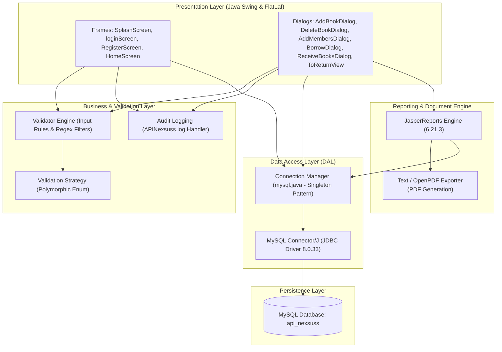
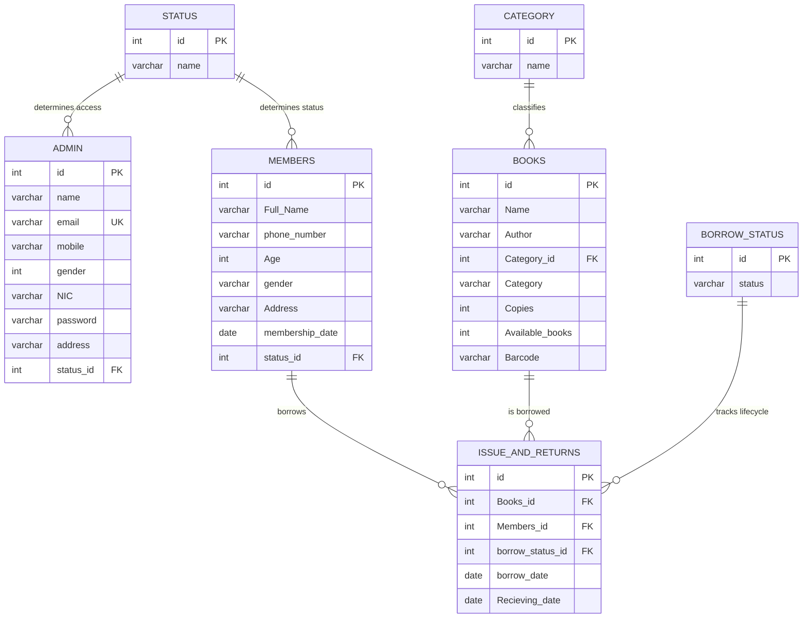

# NexsussAPI - Enterprise Library Management System (LMS)

[](https://www.oracle.com/java/)
[](https://www.mysql.com/)
[](https://www.formdev.com/flatlaf/)
[](https://community.jaspersoft.com/)
[](https://ant.apache.org/)
[](LICENSE)

An enterprise-grade, desktop-based Library Management System developed with Java Swing, MySQL, and FlatLaf modern UI architecture. NexsussAPI automates the end-to-end operational lifecycle of academic and corporate libraries, including catalog management, member registries, circulation tracking, barcode workflows, audit logging, database backups, and JasperReports-powered document reporting.

---

## Table of Contents

- [Executive Summary](#executive-summary)
- [System Architecture](#system-architecture)
- [Software Engineering Design Patterns](#software-engineering-design-patterns)
- [Core Functional Modules](#core-functional-modules)
- [Database Architecture & ER Diagram](#database-architecture--er-diagram)
- [Technology Stack](#technology-stack)
- [Project Directory Structure](#project-directory-structure)
- [Setup & Installation Guide](#setup--installation-guide)
- [Audit Logging & Security](#audit-logging--security)
- [Enterprise Roadmap](#enterprise-roadmap)
- [Author & Contact](#author--contact)

---

## Executive Summary

Manual library administration introduces human error in lending cycles, untracked book depreciations, and inventory discrepancies. NexsussAPI delivers a desktop management platform built for transactional integrity and operational efficiency.

### Key Capabilities

- **Automated Circulation Management:** Real-time atomic inventory tracking upon book issuance and return.
- **Enterprise Reporting:** Automated PDF generation for loan receipts, circulation statistics, and invoices via JasperReports.
- **Modern User Experience:** Built on FlatLaf UI framework with SVG rendering for high-DPI displays.
- **Disaster Recovery:** Built-in SQL dump utility for on-demand database snapshots and recovery.
- **Audit Trails:** Centralized logging with `java.util.logging` capturing administrative actions and security events.

---

## System Architecture

NexsussAPI follows a modular layered architecture to separate presentation, business logic, data access, and persistence.



---

## Software Engineering Design Patterns

The codebase adheres to core object-oriented programming principles and industry design patterns:

### 1. Singleton Pattern (Database Connection Management)
- **Class:** `com.apiNexsuss.connection.mysql`
- **Application:** Encapsulates database connection instantiation. Ensures that only one active JDBC connection pool instance is maintained or reused across dialogs and frames, minimizing socket overhead and connection latency.

### 2. Strategy / Polymorphic Enum Pattern (Validation Subsystem)
- **Classes:** `com.apiNexsuss.validation.Validation` and `com.apiNexsuss.validation.Validator`
- **Application:** The `Validation` enum defines independent validation algorithms (`EMAIL`, `MOBILE`, `PASSWORD`) overriding a common abstract method. This isolates validation regex logic from UI forms, adhering to the Open/Closed Principle (OCP) and Single Responsibility Principle (SRP).

### 3. Layered Separation of Concerns
- Modal interactions (`JDialog`) are separated from the main operational dashboard (`HomeScreen`), preventing UI freeze and enabling non-blocking background query executions.

### 4. Event-Driven Architecture
- Asynchronous UI state changes are decoupled via Swing Event Dispatch Thread (EDT) listeners, ensuring thread safety across table model reloads and database lookups.

---

## Core Functional Modules

### 1. Authentication & Role-Based Access Control
- **Components:** `SplashScreen`, `loginScreen`, `RegisterScreen`
- **Features:**
  - Secure credential validation against administrative records.
  - Multi-state account checks (`status_id = 1` for Active, `status_id = 2` for Suspended).
  - Defensive regex validation for names, phone numbers, and strong password criteria.
  - Audit logging for successful and failed authentication attempts.

### 2. Catalog & Inventory Management
- **Components:** `AddBookDialog`, `DeleteBookDialog`, `HomeScreen`
- **Features:**
  - Complete catalog CRUD (Create, Read, Update, Delete) lifecycle.
  - Category mapping across standard classifications (Fiction, Science, History, etc.).
  - Real-time stock counters tracking both total physical copies (`Copies`) and current available stock (`Available_books`).
  - Barcode assignment using Barbecue barcode generation library.

### 3. Patron & Member Lifecycle Management
- **Components:** `AddMembersDialog`, `HomeScreen`
- **Features:**
  - Member registration capturing contact details, age, gender, NIC, and enrollment date.
  - Active and suspended status enforcement preventing delinquent accounts from borrowing.

### 4. Circulation & Lending Engine
- **Components:** `BorrowDialog`, `ReceiveBooksDialog`, `ToReturnView`
- **Features:**
  - Atomic stock updates: decrements `Available_books` upon book checkout and increments upon book return.
  - Issuance tracking linking book IDs, member IDs, issue dates, and return deadlines.
  - Tabular inspection of overdue and pending returns with relational join views.

### 5. Document & Report Generation
- **Components:** `JasperReports`, `iTextPDF`, compiled `.jasper` templates
- **Features:**
  - Dynamic invoice and circulation report compilation from database queries.
  - Dual preview/export capability: inline review via `JasperViewer` and direct document output to PDF.

### 6. Disaster Recovery & System Diagnostics
- **Components:** Integrated backup handler in `HomeScreen`
- **Features:**
  - One-click schema and table data backup export to structured SQL files.
  - Persistent diagnostic logging via `APINexsuss.log`.

---

## Database Architecture & ER Diagram

The relational schema is designed in Third Normal Form (3NF) to maintain data consistency and referential integrity.



---

## Technology Stack

| Category | Component | Purpose |
|:---|:---|:---|
| **Language** | Java Standard Edition (SE 17+) | Core application logic and desktop runtime |
| **GUI Framework** | Java Swing + FlatLaf 3.6 | Modern, themeable, high-DPI desktop interface |
| **Graphics & Icons** | JSVG 1.4.0, FlatLaf Extras | Vector SVG asset rendering and desktop styling |
| **Database** | MySQL Server 8.0+ | Relational persistence and transactional storage |
| **Database Driver** | MySQL Connector/J 8.0.33 | High-performance JDBC connectivity |
| **Reporting** | JasperReports 6.21.3 | Enterprise document compilation and PDF exporting |
| **PDF Generation** | iText 2.1.7 / iTextPDF 5.5.13 / OpenPDF | Document stream rendering and PDF export formatting |
| **Barcode Utility** | Barbecue 1.5 Beta 1 | Asset tagging and barcode generation |
| **Build System** | Apache Ant / NetBeans Ant Harness | Compilation, dependency packaging, and distribution |
| **Packaging** | Launch4j | Executable wrapper producing native Windows `.exe` |

---

## Project Directory Structure

```text
NexsussApi/
├── database/
│   └── schema.sql                   # Complete DDL & initial seed data script
├── dist/
│   ├── NexsussAPI.jar               # Compiled distribution artifact
│   ├── README.TXT                   # NetBeans runtime instructions
│   └── lib/                         # Packaged runtime dependencies
├── lib/                             # Core library archive (JAR dependencies)
│   ├── barbecue-1.5-beta1.jar
│   ├── flatlaf-3.6.jar
│   ├── jasperreports-6.21.3.jar
│   └── mysql-connector-j-8.0.33.jar
├── nbproject/                       # NetBeans project configuration
│   ├── build-impl.xml
│   └── project.properties
├── src/
│   ├── com/apiNexsuss/
│   │   ├── connection/
│   │   │   └── mysql.java           # JDBC Connection Manager (Singleton)
│   │   ├── dialogs/
│   │   │   ├── AddBookDialog.java   # Book registration dialog
│   │   │   ├── AddMembersDialog.java# Member enrollment dialog
│   │   │   ├── BorrowDialog.java    # Circulation checkout workflow
│   │   │   ├── DeleteBookDialog.java# Book decommission dialog
│   │   │   ├── ReceiveBooksDialog.java# Book return check-in workflow
│   │   │   └── ToReturnView.java    # Overdue/pending ledger view
│   │   ├── screens/
│   │   │   ├── SplashScreen.java    # Application entry point & preloader
│   │   │   ├── loginScreen.java     # Admin authentication frame
│   │   │   ├── RegisterScreen.java  # Admin onboarding frame
│   │   │   ├── HomeScreen.java      # Central operational dashboard
│   │   │   └── AppIconUtil.java     # Icon resource helper
│   │   └── validation/
│   │       ├── Validation.java      # Regex validation strategy enum
│   │       └── Validator.java       # Form input validation service
│   ├── img/                         # SVG and PNG graphic resources
│   └── report/                      # Compiled JasperReports templates (.jasper)
├── build.xml                        # Apache Ant build script
├── manifest.mf                      # JAR manifest configuration
├── nexsussapilms.xml                # Launch4j executable configuration
├── nexsussApiLms.exe                # Native Windows executable binary
└── README.md                        # Project documentation
```

---

## Setup & Installation Guide

### Prerequisites

Ensure the following tools are installed on your workstation:
1. **Java Development Kit (JDK):** Version 17 or higher
2. **MySQL Community Server:** Version 8.0 or higher
3. **Apache NetBeans IDE (Optional):** Version 17+ (or standalone Apache Ant 1.10+)

---

### Step 1: Database Initialization

1. Start your local MySQL service.
2. Open a terminal or MySQL Workbench and execute the setup script located in [`database/schema.sql`](database/schema.sql):

```bash
mysql -u root -p < database/schema.sql
```

This creates the database `api_nexsuss`, builds all required tables with primary/foreign key constraints, and seeds default records:
- **Default Admin Account:**
  - **Email:** `admin@nexsuss.com`
  - **Password:** `Admin@123`

---

### Step 2: Configure Database Credentials

Open [`src/com/apiNexsuss/connection/mysql.java`](src/com/apiNexsuss/connection/mysql.java) and verify your local MySQL credentials:

```java
private static final String DATABASE = "api_nexsuss";
private static final String USERNAME = "root";
private static final String PASSWORD = "your_mysql_password";
```

*(Ensure the same credentials match in frames performing direct statements, or route all operations through `mysql.createConnection()`.)*

---

### Step 3: Build & Run

#### Option A: Run via NetBeans IDE
1. Open NetBeans and choose **File** > **Open Project**.
2. Select the `NexsussApi` directory.
3. Right-click the project root and click **Clean and Build**.
4. Click **Run Project** (or press `F6`).

#### Option B: Build via Apache Ant (Command Line)
```bash
# Clean and compile the project
ant clean
ant compile
ant jar

# Execute the compiled JAR
java -jar dist/NexsussAPI.jar
```

#### Option C: Native Windows Executable
Launch the bundled executable directly on 64-bit Windows environments:
```bash
.\nexsussApiLms.exe
```

---

## Audit Logging & Security

The system integrates Java Logging API (`java.util.logging.Logger`) configured to output diagnostic events to `APINexsuss.log`.

### Logged Operations Include:
- Administrative authentication attempts (success and failure timestamps).
- Account authorization rejections (suspended status detection).
- Catalog decommissions and book deletion operations with record IDs.
- Database backup creation triggers and file destination paths.

Sample log entry:
```text
INFO: [SUCCESS] admin@nexsuss.com logged in at Sat Nov 07 10:15:22 IST 2026
INFO: [BACKUP] Database configuration dumped to lms_db_backup.sql
```

---

## Enterprise Roadmap

To align this desktop solution with modern cloud-native architectures, the following architectural upgrades are planned:

1. **Backend Decoupling:** Re-architect data operations into a **Spring Boot 3.x RESTful API** service layer.
2. **Modern Web Client:** Develop a responsive Single Page Application (SPA) using **React.js** and **TypeScript**.
3. **Security Enhancements:** Replace plain-text password matching with **BCrypt hashing** and implement **JWT (JSON Web Tokens)** with Role-Based Access Control (RBAC).
4. **ORM Migration:** Replace raw JDBC SQL queries with **Hibernate / Spring Data JPA** for entity caching and transaction management.
5. **CI/CD Pipeline:** Implement GitHub Actions for automated build validation, SonarQube static code analysis, and JUnit 5 test coverage.

---

## Author & Contact

**R A Savindu Geethma**  
Software Engineering Undergraduate | Aspiring Software Engineer  

- **LinkedIn:** [linkedin.com/in/savindu-geethma-249317305](https://www.linkedin.com/in/savindu-geethma-249317305)  
- **Role Target:** Software Engineering Intern (Enterprise Systems & Backend Development)

---

## License

This project is licensed under the MIT License - see the [LICENSE](LICENSE) file for details.
